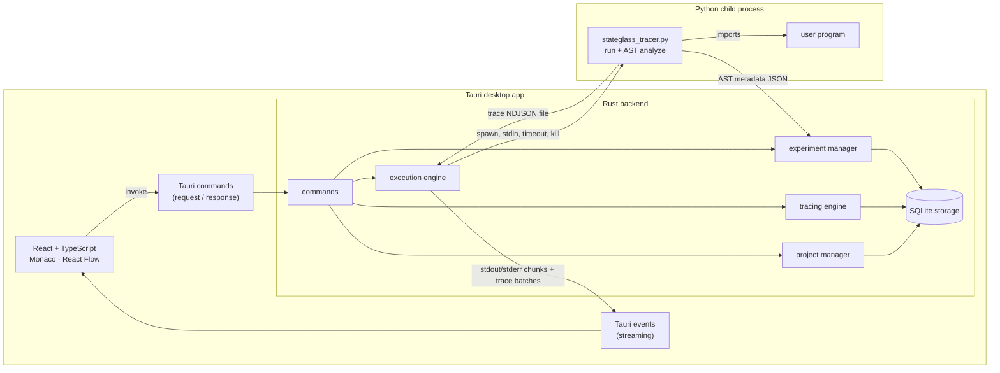

# Stateglass

Stateglass is a desktop debugging IDE built around two questions:

1. **Where did this incorrect value come from?**
2. **What happens if I change the code that produced it?**

Instead of stopping at breakpoints, Stateglass records an execution trace, lets you
inspect every recorded variable change with its function and source line, draws a
data-flow graph from static assignments plus runtime snapshots, and lets you run
isolated experiments against the same recorded command so you can compare both
executions side by side.

The original project folder is never modified when creating or running experiments.

> **Status:** the first version is functional end to end for Python 3.11+. The
> architecture keeps execution/language support behind explicit boundaries so other
> runtimes can be added later; only Python is implemented today.

---

## Contents

- [Features](#features)
- [Quick start](#quick-start)
- [A five-minute tour](#a-five-minute-tour)
- [Architecture](#architecture)
- [How tracing works](#how-tracing-works)
- [How data flow is built](#how-data-flow-is-built)
- [Experiments and comparison](#experiments-and-comparison)
- [Persistence and local data](#persistence-and-local-data)
- [Security, limits and honest caveats](#security-limits-and-honest-caveats)
- [Testing](#testing)
- [Repository layout](#repository-layout)
- [Extending to other languages](#extending-to-other-languages)
- [Development utilities](#development-utilities)
- [Troubleshooting](#troubleshooting)
- [Non-goals](#non-goals)

---

## Features

| Area | What works today |
| --- | --- |
| Projects | Open any local folder, file tree with ignore rules, safe path resolution, entry-point detection, persisted run settings, filesystem watching, recent projects |
| Editor | Monaco with Python highlighting, multiple tabs, dirty tracking, `⌘S`, jump-to-line from traces, entry-point badge |
| Execution | Python child process, stdout/stderr streamed live, exit codes, timeout with process-group termination, cancellation, peak memory, duration |
| Tracing | `sys.settrace` helper, NDJSON events, variable history, call/return/exception events, per-line attribution, configurable limits, truncation signalling |
| Inspection | Variables at any point in the timeline, history for a selected variable, function/line navigation, interactive timeline with filters and scrubbing |
| Data flow | AST assignment metadata joined with runtime snapshots, React Flow graph, assignment site table, source navigation |
| Experiments | Isolated project copies, multiple experiments per baseline, replay of recorded entry point/args/stdin/timeout, edit the copy without touching the original |
| Comparison | Side-by-side metrics, unified output/error diffs, variable diff table, explicit nondeterminism warnings |
| UX | Dark theme, resizable panels (persisted), keyboard shortcuts, loading/empty states, live status, graceful errors |

---

## Quick start

### Requirements

- macOS, Linux, or Windows with [Tauri 2 prerequisites](https://tauri.app/start/prerequisites/)
  (Rust 1.77+, platform webview build dependencies, Node 20+)
- Python **3.11 or newer** on `PATH` (a project `.venv` is detected automatically)
- No cloud account, API key, telemetry, or network service is required

### Install and run

```bash
npm install
npm run dev          # starts the Vite frontend + Tauri desktop shell
```

Build a standalone app:

```bash
npm run tauri:build  # production bundle for the current OS
```

Open a project directly from a terminal:

```bash
# built binary (debug or bundled app)
./src-tauri/target/debug/stateglass /path/to/python/project

# in development, pass app arguments after a second `--`
npm run tauri -- dev -- -- /path/to/python/project
```

The bundled sample lives at [`samples/python-demo`](samples/python-demo). Use
**Try the sample project** on the welcome screen to copy it into the app data
directory and open it.

---

## A five-minute tour

The sample is a four-file pricing pipeline with one intentional bug.

1. **Open the sample** and press `⌘↵` (`Ctrl+Enter` on Windows/Linux). The first
   run asks for consent, then starts a traced baseline execution.
2. Watch stdout stream in the console; the timeline fills with variable, call and
   exception events.
3. Select `total` in the **Variables** inspector. Its history shows every recorded
   assignment with the function and line that produced it.
4. Click a history row to move the timeline cursor to that moment, or use the arrow
   button to jump to the exact source line. The changed line is highlighted.
5. Open **Data Flow** for `total` to see the runtime value history and the AST
   sources that fed each change. Click any node to jump to its line.
6. Open **Experiments** → **New experiment**, name it, and keep the recorded
   baseline. Stateglass copies the project into its own data directory and opens
   the copy.
7. Edit `pricing.py` in the copy: change
   `tax = round(subtotal * TAX_RATE, 2)` to `tax = round(discounted * TAX_RATE, 2)`.
8. Run the experiment. Then open **Compare** to see output divergence, duration and
   memory deltas, the full diff, and which variables changed. The original folder
   still contains the buggy code.

Keyboard shortcuts are available from the keyboard icon in the header.

---

## Architecture

Stateglass is a Tauri 2 application. Rust owns all application logic and state;
React only renders and forwards user intent. Python introspection lives in a
separate helper process.



### Rust modules

| Module | Responsibility |
| --- | --- |
| `src-tauri/src/project.rs` | Open/import folders, ignore rules, entry-point detection, safe path resolution, text read/write, bundled sample |
| `src-tauri/src/execution.rs` | Child-process lifecycle, streaming pipes, timeout and process-group cleanup, resource sampling, trace-file tailing, event emission |
| `src-tauri/src/tracing.rs` | NDJSON framing/parsing, variable history queries and data-flow graph construction |
| `src-tauri/src/experiments.rs` | Recursive project copying, experiment creation, unified diffing, variable comparison, warnings |
| `src-tauri/src/storage.rs` | SQLite schema, migrations and all persistence queries |
| `src-tauri/src/python.rs` | Interpreter discovery/validation, tracer location, AST analysis orchestration |
| `src-tauri/src/watchers.rs` | Debounced filesystem notifications for open workspaces |
| `src-tauri/src/commands.rs` | Thin Tauri IPC layer; validates inputs and delegates |
| `src-tauri/src/models.rs` | Serializable DTOs (serde `camelCase`) shared with the UI |

### Frontend modules

| Path | Responsibility |
| --- | --- |
| `src/store.ts` | Zustand store: workspace, sessions, trace selection, files, UI state, run orchestration |
| `src/api.ts` | Typed `invoke` wrappers and event subscriptions |
| `src/lib/format.ts`, `src/lib/tree.ts` | Formatting, argument parsing, file tree building/filtering (unit tested) |
| `src/components/Header.tsx` | Project/workspace identity, run cluster, session selection, run settings |
| `src/components/EditorPane.tsx` | Monaco, tabs, trace-line reveal decorations |
| `src/components/Timeline.tsx` | Filterable event timeline, density strip, scrubbing, source jump |
| `src/components/VariableInspector.tsx` | Snapshot table plus per-variable history |
| `src/components/DataFlowPanel.tsx` | React Flow graph and assignment-site table |
| `src/components/ExperimentsPanel.tsx` | Experiment list, run/compare actions |
| `src/components/ComparePanel.tsx` | Metrics, warnings, diffs, variable comparison |
| `src/components/ConsolePanel.tsx` | Live/settled stdout and stderr |
| `src/components/Dialogs.tsx` | Consent, new experiment, shortcuts |

### IPC surface

Commands are request/response; long-running work reports through events.

**Commands:** `bootstrap`, `list_projects`, `open_project`, `create_sample_project`,
`get_project`, `update_project_config`, `set_project_consent`, `list_files`,
`read_file`, `write_file`, `analyze_workspace`, `start_run`, `cancel_run`,
`list_sessions`, `get_session`, `get_session_output`, `list_trace_events`,
`trace_stats`, `variables_at`, `variable_history`, `data_flow`,
`create_experiment`, `list_experiments`, `compare_sessions`,
`list_python_runtimes`, `set_global_python_path`.

**Events:** `run:output`, `run:trace`, `run:stats`, `run:finished`,
`workspace:changed`.

---

## How tracing works

[`python/stateglass_tracer.py`](python/stateglass_tracer.py) has no third-party
dependencies. It has two modes:

### `run`

```
python3 stateglass_tracer.py run \
  --trace-file <session>.ndjson --root <project> \
  --events-limit 200000 --value-limit 180 \
  --max-depth 40 --max-locals 64 -- <entry>.py [args...]
```

- Installs `sys.settrace` (and `threading.settrace`) and traces frames whose real
  path is inside the project root, skipping the standard library, site-packages
  and the helper itself.
- Emits newline-delimited JSON events (see below) and runs the entry file with
  `runpy.run_path(..., run_name="__main__")`.
- Program stdout/stderr are **not** used for tracing, so the application's output
  remains untouched.
- Exceptions are reported and the process exits with a non-zero code; `SystemExit`
  codes are preserved.
- Event volume is capped. On overflow a `truncated` event is emitted and tracing
  stops while the program continues.

### `analyze`

Parses Python files with `ast` and prints assignment metadata:

```json
{
  "files": [{
    "file": "pricing.py",
    "assignments": [{
      "line": 39, "col": 4, "func": "compute_order_total",
      "target": "tax", "sources": ["subtotal", "TAX_RATE"],
      "callee": "round", "kind": "assign"
    }],
    "functions": [{ "line": 24, "name": "compute_order_total", "kind": "function" }],
    "errors": []
  }]
}
```

Handled constructs include normal/annotated/augmented assignment, `for`, `with`,
walrus expressions, tuple targets, attributes (`self.total`) and subscript targets.
Syntax errors are reported per file and never crash the app.

### Event protocol

| Kind | Meaning | Key fields |
| --- | --- | --- |
| `session_start` | Tracer started | `root`, `entry`, `argv`, `python` |
| `call` | Function entered | `frame`, `parent`, `depth`, `file`, `line`, `func` |
| `line` | Source line about to execute | `frame`, `file`, `line`, `func` |
| `var` | Local value created/changed | `frame`, `name`, `value`, `vtype`, `file`, `line`, `func` |
| `return` | Function exited | `frame`, `file`, `line`, `func`, `value`, `vtype` |
| `exception` | Unhandled or handled exception | `vtype`, `value`, `file`, `line` |
| `truncated` | Event budget exhausted | `limit`, `events` |
| `session_end` | Footer | `status`, `exit_code`, `error`, `duration_ms`, `truncated` |

All events also carry monotonically increasing `seq` and epoch-millisecond `ts`.

**Line attribution:** Python fires a `line` event *before* executing that line, so
a change is observed at the next line event. Stateglass attributes the change to
the previously executed line, which matches the assignment that produced it. This
is covered by tests.

### Safe value capture

Values are never pickled or blindly serialized:

- primitives are `repr`-limited to a configurable length;
- lists/tuples/dicts/sets are rendered shallowly (max 12 items, depth 2, cycle-safe,
  sets sorted for stability);
- arbitrary objects become `<ClassName>` so memory addresses do not leak into diffs;
- frames are capped by depth and number of locals, and dunder names are skipped.

`repr()` of a user object can execute user code — exactly like a conventional
debugger. This is documented rather than hidden.

### Known trace limitations

- C extensions, native calls and subinterpreters are not traced.
- Child processes (e.g. `multiprocessing`) are not instrumented (new threads are).
- Global variables mutated inside functions are observed when the module frame next
  samples its locals; local variables are sampled per line.
- Sampling is line-granular, not every bytecode write.
- Traces are capped at 200,000 events by default.
- Instrumentation slows execution; comparisons include that overhead.

---

## How data flow is built

Data flow is **inferred**, never fabricated:

1. The AST analyzer records every assignment site with the names it reads.
2. The runtime records each variable change with `file`, `line`, `func` and `seq`.
3. For the selected variable, Stateglass takes its most recent 24 changes and
   matches each to a static assignment in the same file/function/line (falling back
   to the nearest preceding assignment in that function).
4. For each matched source name, the most recent earlier runtime snapshot of that
   name is found and connected as an edge labelled with the source name.
5. Consecutive changes of the target are connected with `update` edges.

The response includes `assignmentSites` with a `matched` flag, so the UI can be
honest about which edges came from AST metadata and which are runtime-only. When
analysis is unavailable, the graph still shows the runtime history with a note.

---

## Experiments and comparison

Creating an experiment:

- saves any unsaved editor buffers, then validates that the baseline belongs to the
  project, is a baseline, and has finished;
- copies every non-ignored file (no `.git`, virtualenvs, caches, build output) to
  `<app-data>/experiments/<id>/project`; the copy reflects the project's current
  on-disk state;
- writes `experiment.json` metadata next to the copy;
- analyzes the copy separately, so the copy's own assignments power its data flow;
- registers the experiment in SQLite. Nothing is deleted afterwards.

Running an experiment:

- reuses the baseline's **entry file, arguments, stdin, timeout and interpreter**
  (falling back to the newest supported interpreter if the recorded one is gone);
- runs in the copy's directory with a new session id, trace file and output;
- captures the same metrics as a baseline run.

Comparison shows:

- status, exit code, duration and peak memory for each side;
- a line diff of stdout and stderr (with context around changes);
- final value of every variable present in either trace, marked
  `same`/`changed`/`added`/`removed`;
- the first stdout divergence line;
- explicit warnings about replay fidelity, truncation, status differences and
  error messages.

**Replay is not guaranteed to be identical.** External services, databases,
clocks, randomness, filesystem state, network access and instrumentation overhead
can change results. The UI says so in every comparison.

---

## Persistence and local data

SQLite database: `<app-data>/stateglass.sqlite3`.

| Platform | App data directory |
| --- | --- |
| macOS | `~/Library/Application Support/dev.stateglass.app/` |
| Linux | `~/.local/share/dev.stateglass.app/` |
| Windows | `%APPDATA%\dev.stateglass.app\` |

Tables: `projects`, `sessions`, `trace_events`, `assignments`, `experiments`,
`settings`. Trace files are kept as NDJSON under `<app-data>/traces/`; experiment
copies live under `<app-data>/experiments/`; the bundled sample is copied to
`<app-data>/samples/python-demo`.

Stored stdout/stderr are capped at 3 MB per stream; trace events at 200k per
session. The database keeps run history across restarts.

---

## Security, limits and honest caveats

- **Not a sandbox.** Project code runs as a child process with your user
  privileges. There is no container, namespace or VM isolation. Consent is required
  once per project before the first run.
- **Process cleanup.** On Unix the child starts in its own process group; timeout
  and cancellation send `SIGKILL` to the group. On Windows `taskkill /T /F` is used.
  Descendants that deliberately detach can still escape cleanup.
- **Timeouts** default to 20 s and are clamped to 1–600 s. Timeout is reported as
  `timeout` and the session records the reason.
- **No network calls** are made by Stateglass itself. Project code may make its own.
- **File boundaries.** Backend file operations reject absolute paths, `..`
  traversal and canonicalized paths outside the active workspace root. Experiments
  are always copies.
- **Trace file size** grows with executed lines; limits bound memory, DB size and
  UI work.
- **Local only.** No accounts, paid APIs, AI features or language models.

---

## Testing

```bash
# Rust unit + integration tests (spawns real Python helper processes)
cd src-tauri && cargo test

# Frontend logic tests (formatting, argument parsing, file tree)
npm test

# Python tracer and analyzer tests
python3 -m unittest discover -s python/tests -v

# Type checking and production frontend build
npx tsc --noEmit && npm run build
```

Coverage highlights:

- storage CRUD, trace queries, variable snapshots, history ordering;
- path traversal and binary-file rejection;
- project copy isolation (original file unchanged after editing the copy);
- end-to-end traced execution with real Python: variable history, stdout, peak
  memory, event streaming;
- timeout enforcement against an infinite loop;
- experiment creation, replay, output divergence, variable comparison, preserved
  history, data-flow construction;
- Python summarization safety, line attribution, event limits, error reporting,
  AST dependencies, stdlib frame exclusion;
- NDJSON framing across partial chunks;
- frontend formatting and tree/filter behavior.

Integration tests skip nothing — they require Python 3.11+ to be installed.

---

## Repository layout

```
.
├── README.md
├── package.json
├── vite.config.ts
├── src/                       React + TypeScript UI
│   ├── components/            Panels, dialogs, timeline, graphs
│   ├── lib/                   Pure helpers (unit tested)
│   ├── api.ts                 Typed Tauri IPC bindings
│   ├── store.ts               Application state
│   ├── monaco.ts              Editor bootstrap + theme
│   ├── styles.css             Dark design system
│   └── types.ts               DTOs mirroring Rust models
├── src-tauri/
│   ├── src/                   Rust backend modules (see table above)
│   ├── tests/                 End-to-end execution/experiment tests
│   ├── examples/seed_demo.rs  Developer data seeding utility
│   ├── capabilities/          Tauri permissions (core + dialog)
│   └── tauri.conf.json        App config and bundled tracer resource
├── python/
│   ├── stateglass_tracer.py   Runtime instrumentation + AST analyzer
│   └── tests/                 unittest suite
├── samples/python-demo/       Buggy pricing pipeline used in demos/tests
└── scripts/gen_icons.py       Dependency-free icon generator
```

---

## Extending to other languages

Only Python is implemented. The boundaries that keep this maintainable:

- `execution.rs` only knows how to spawn an interpreter with an entry file, stream
  its output, enforce timeouts and tail an NDJSON event file.
- `RawTraceEvent` / `TraceEvent` are a small, language-neutral event vocabulary
  (call, line, var, return, exception, end).
- `assignments` are language-neutral records of `target` + `sources` per line and
  function. A new language needs an analyzer that emits the same shape.
- Sessions store the interpreter path and command-line arguments as data, not code.

A future language adapter would add: entry-point detection, interpreter discovery,
a tracer/analyzer helper implementing the event and analysis schemas, and a language
mode in the editor. No frontend rewrite is required.

---

## Development utilities

`src-tauri/examples/seed_demo.rs` populates a database with a real baseline and a
real experiment for the sample project (useful for demos, documentation and manual
QA):

```bash
cd src-tauri
cargo run --example seed_demo -- ../samples/python-demo \
  "$HOME/Library/Application Support/dev.stateglass.app"
```

`scripts/gen_icons.py` regenerates all app icons without external image libraries.

---

## Troubleshooting

**“No Python 3.11+ interpreter was found.”**
Install Python 3.11+, add it to `PATH`, or set an interpreter per project in Run
settings. Project `.venv/bin/python` (and `Scripts/python.exe`) are detected.

**“The Python instrumentation helper is missing.”**
In development the helper is resolved from `python/stateglass_tracer.py`; in a
bundle it is included as a Tauri resource. Reinstall or set `STATEGLASS_TRACER` to
an absolute path.

**A run times out.**
Increase the timeout in Run settings. Timeouts kill the process group and are
recorded as `timeout`, not as a trace error.

**Data-flow edges are missing.**
Run **re-analyze** (refresh icon in the header). Large files (>512 KB), generated
code or dynamic constructs may not produce AST metadata; the graph note will say so.

**Output is truncated.**
Per-stream output is capped at 3 MB and traces at 200k events. This is deliberate
to keep the app responsive.

**Linux build fails.**
Install the Tauri prerequisites (`webkit2gtk-4.1`, `libappindicator`, build tools)
for your distribution.

---

## Non-goals

- No security sandbox or remote execution.
- No cloud accounts, collaboration, telemetry or paid APIs.
- No AI features or local language models.
- No claim that a replay is byte-for-byte reproducible.
- No support for every language in the first version.
