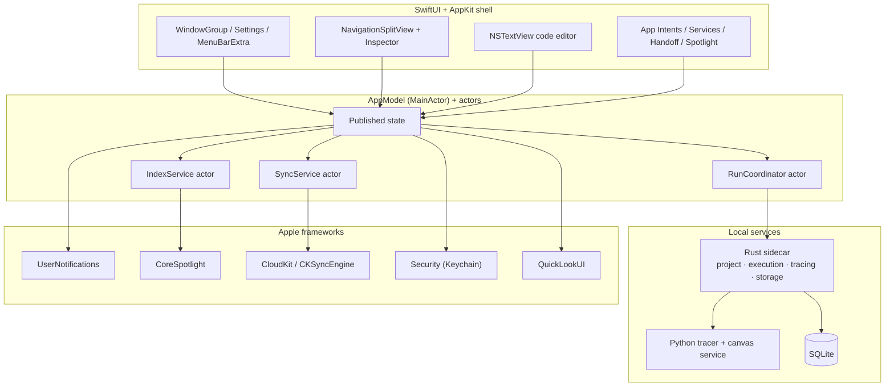

# Stateglass — Apple‑First Redesign

**Status:** proposed + Phase 0 implemented
**Target:** macOS 27.3 SDK, deployment target macOS 26.0 (Tahoe), forward‑compatible with 27‑only APIs behind `if #available(macOS 27, *)`
**Toolchain verified locally:** macOS 27.3, Xcode 27.2, Swift 6.4.2, macOS 27.2 SDK
**Audience:** product, design, and engineering

---

## 0. Decision summary

Stateglass is already a native SwiftUI app, not an Electron app. The gap is not the language; it is the **shell, system integration, distribution, and developer workflow**. This redesign keeps the existing Rust sidecar and Python tracer as back‑end services and makes the macOS surface feel like a first‑class Apple IDE:

1. **Native shell:** `WindowGroup` + `NavigationSplitView` + `.inspector` + `.toolbar` + `Settings` scene, semantic system colors, `NSTextView` editing, native menus, focus, search, context menus, drag‑and‑drop, Quick Look, and state restoration.
2. **System citizenship:** menu bar extra, Dock menu, Services, Share sheet, notifications, Spotlight, Handoff, App Intents/Shortcuts, Keychain, Focus filters, widgets, and CloudKit — each mapped to a specific Apple framework.
3. **Apple developer workflow:** Swift/SwiftUI IDE features, SPM/Xcode support, AppleScript/JXA, hardened runtime, notarization, universal binaries, and an explicit sandbox strategy.
4. **No new web UI:** the existing Tauri/React tree is legacy reference only. It is not part of the shipping macOS shell and should be deleted once parity is verified.

The Phase 0 code in this change implements the highest‑impact, lowest‑effort parts of that plan. Everything else is sequenced below.

---

## 1. Scope, assumptions, and open questions

### Assumptions

- Stateglass is a **local‑first developer tool**. Users run untrusted‑in‑principle project code with their own privileges, exactly like a terminal.
- Trace data is sensitive (variable values can contain secrets). Cloud sync is **opt‑in and metadata‑first**.
- Python is the only traced language today; Swift/SwiftUI support is a new workstream, not a refactor of the tracer.
- The Rust sidecar remains the execution/tracing authority in the near term. Moving it into Swift is not required for an Apple‑first UX.

### Open questions (need product decisions, not code)

1. **Distribution:** Mac App Store, Developer ID + notarized DMG, or both? App Store review has a hard conflict with arbitrary code execution and helper processes.
2. **CloudKit scope:** sync project metadata/settings only, or also trace events and captured values? The latter creates real privacy and size problems.
3. **Widget content:** is there a genuinely useful glanceable metric (last run status, duration, failure count), or is a widget merely decorative?
4. **AppleScript surface:** are `open project` / `run project` enough, or do teams need query commands and result objects?
5. **Intel support:** how long must universal binaries include x86_64?
6. **Legacy removal:** when may `src/`, `src-tauri/tauri.conf.json`, and the Tauri dev scripts be deleted?

---

## 2. Current‑state audit

| Area | Finding | Evidence | Severity |
| --- | --- | --- | --- |
| Appearance | Forces dark mode, ignores system appearance | `xcode/Sources/StateGlass/StateGlassApp.swift` (`preferredColorScheme(.dark)`) | High |
| Color | Hardcoded RGB palette in three places | `ContentView.swift` `Palette`, `CanvasView.swift` `CanvasPalette`, `FlowGraphView.swift` | High |
| Window chrome | Custom `HSplitView`/`VSplitView` + hand‑rolled header, not a standard toolbar/sidebar/inspector | `ContentView.swift` `WorkspaceView`, `WorkspaceToolbar` | High |
| Editor | SwiftUI `TextEditor`; no find bar, no native undo guarantees, no text storage hooks | `ContentView.swift` `EditorPanel` | High |
| Settings | No `Settings` scene; run settings buried in a toolbar `Menu` | `StateGlassApp.swift`, old `SettingsMenu` | Medium |
| System integration | No menu bar extra, Dock menu, Services, notifications, Spotlight, Handoff, App Intents, Quick Look | absent | High |
| Distribution | Info.plist lacks capabilities; no entitlements; no signing/notarization; no universal binary | `scripts/build-macos.sh` | High |
| Performance | Canvas client starts a new Python process **per request** | `CanvasBackendClient.swift` `perform` | High |
| Accessibility | Many custom `.buttonStyle(.plain)` rows lack labels/traits; custom focus styling | multiple views | Medium |
| Architecture | `ContentView.swift` (~780 lines) and `AppModel.swift` (~700 lines) are monoliths | file sizes | Medium |
| State | Only recent project + center tab persisted | `AppModel.start`, `UserDefaults` | Medium |
| Sandbox | App runs arbitrary code and child processes with no sandbox strategy | `execution.rs`, Python spawn | High |
| Legacy | Full Tauri/React tree still present and can drift | `src/`, `src-tauri/`, `package.json` | Medium |

**Conclusion:** the app is native in implementation but not yet native in *feel* or *system citizenship*. Phase 0 closes the most visible gaps; the roadmap handles the rest.

---

## 3. Target architecture



### Responsibility split

- **SwiftUI/AppKit**: presentation, commands, focus, accessibility, window/scene lifecycle, system integrations.
- **AppModel + actors**: UI‑safe state and orchestration. Long‑lived work moves out of `AppModel` into actors (`RunCoordinator`, `IndexService`, `SyncService`).
- **Rust sidecar**: project IO, safe path resolution, execution lifecycle, tracing persistence, diffing. It is a *service*, not UI.
- **Python**: tracer + AST metadata; canvas domain persistence. The canvas client must become a **long‑lived process or XPC service**, not one process per request.
- **CloudKit**: metadata/settings sync only in Phase 2. Never uploaded by default: stdout/stderr, variable values, source files.

### Deployment‑target policy

- Set `platforms: [.macOS(.v26)]` and `LSMinimumSystemVersion = 26.0`.
- Build against the 27.3 SDK.
- Use SDK‑27 features only behind availability checks, for example:

```swift
if #available(macOS 27, *) {
    // New 27-only API
} else {
    // macOS 26 fallback
}
```

No invented “27‑only” framework names appear in this plan. The redesign works on 26 and gains 27 refinements where the SDK provides them.

---

## 4. UX redesign

### 4.1 Window and navigation

**Before:** custom header row, `HSplitView` of three panes, custom tab strip.
**After:** standard macOS structure:

- `NavigationSplitView` with a true sidebar (`List(.sidebar)`), collapsible via the system sidebar command.
- Detail area with `VSplitView` for editor + console.
- `.inspector` for variables/timeline, toggled from the toolbar and View menu.
- Unified toolbar with Open, Sample, Run, Cancel, session picker, Settings, Inspector.
- `.navigationTitle` / `.navigationSubtitle` show project name and path.
- `.searchable` on the sidebar (system search field, ⌘F routing).
- Status bar retained as a thin non‑chrome footer.

### 4.2 Appearance and accessibility

- Remove `preferredColorScheme(.dark)`.
- Replace all fixed colors with semantic `NSColor`: `windowBackgroundColor`, `controlBackgroundColor`, `separatorColor`, `secondaryLabelColor`, `systemGreen/Red/Orange`, `Color.accentColor`.
- This automatically supports dark mode, light mode, Increase Contrast, Reduce Transparency, and user accent colors.
- Custom rows get `.accessibilityLabel`, `.accessibilityHint`, and `.accessibilityAddTraits(.isSelected)`.
- Need more: VoiceOver rotor labels, keyboard‑only traversal, `.focusable` on custom controls, Reduce Motion alternatives for `.symbolEffect(.pulse)`.

### 4.3 Editing

- Replace `TextEditor` with `NSTextView` via `NSViewRepresentable`.
- Native gains: undo/redo, Find bar, selection behavior, accessibility text semantics, text storage for future syntax highlighting.
- Future: `NSRulerView` line numbers, `NSTextStorage` attributes, `SourceKit‑LSP`/`SwiftSyntax` completion.
- Keyboard: ⌘S, ⌘↵ run, ⌘. cancel, ⌘O open, ⌘, settings, ⌘0–4 views.

### 4.4 Files and inspection

- Sidebar rows: context menu with Open, Quick Look, Reveal in Finder, Copy Path.
- Drag files out via `NSItemProvider` and `NSPasteboard`.
- Drop a folder anywhere on the workspace to open it.
- Quick Look uses `QLPreviewPanel`, not a web preview.
- Timeline/variables remain in the inspector; future split into a dedicated Debug area.

### 4.5 System surfaces

- **Menu bar extra:** Show, Open, Run, Cancel, Settings, Quit.
- **Dock menu:** Open, Run, Share project folder.
- **Services:** “Open Project in Stateglass” in Finder’s Services menu.
- **Notifications:** run completion, respecting Focus and notification settings.
- **Handoff:** continue the open project on another Mac.
- **Spotlight:** projects appear as searchable items.
- **Shortcuts:** Run Project / Open Project, plus Siri phrases.
- **AppleScript/JXA:** `open project`, `run project`.

---

## 5. Prioritized roadmap

Scoring: **Impact** 1–5 (user value / acceptance criteria coverage), **Effort** S/M/L, **Score** = impact ÷ effort weight (S=1, M=2, L=3). Higher is earlier.

| # | Phase | Workstream | Impact | Effort | Score | Notes |
| --- | --- | --- | --- | --- | --- | --- |
| 1 | P0 | Semantic appearance + remove forced dark | 5 | S | 5.0 | Largest HIG win per line changed |
| 2 | P0 | `NavigationSplitView` + `.inspector` + toolbar | 5 | M | 2.5 | Native chrome, collapse, focus |
| 3 | P0 | `NSTextView` editor | 4 | S | 4.0 | Find/undo/accessibility |
| 4 | P0 | `Settings` scene | 4 | S | 4.0 | Standard ⌘, and app menu |
| 5 | P0 | Menu bar extra + Dock menu + Services | 4 | S | 4.0 | Visible native citizenship |
| 6 | P0 | Notifications + Spotlight + Handoff + App Intents | 4 | M | 2.0 | System reach |
| 7 | P0 | Quick Look + drag/drop + context menus | 3 | S | 3.0 | Expected file behavior |
| 8 | P0 | Entitlements, hardened runtime, signing, notarization, universal build | 5 | M | 2.5 | Distribution blocker |
| 9 | P1 | Persistent sidecar/XPC; kill process‑per‑request | 5 | M | 2.5 | Performance and latency |
| 10 | P1 | Split `ContentView`/`AppModel` into modules | 3 | M | 1.5 | Maintainability |
| 11 | P1 | Accessibility audit + keyboard traversal + focus rings | 5 | M | 2.5 | Acceptance criteria |
| 12 | P1 | State restoration (windows, tabs, scroll, selection) | 3 | S | 3.0 | Native expectation |
| 13 | P1 | Quick Open (⌘P) + command palette | 4 | M | 2.0 | IDE credibility |
| 14 | P1 | AppleScript/JXA command surface expansion | 2 | M | 1.0 | Power users |
| 15 | P2 | CloudKit metadata sync (`CKSyncEngine`) | 3 | L | 1.0 | Opt‑in only |
| 16 | P2 | WidgetKit widget (last run) | 2 | M | 1.0 | Useful if metric chosen |
| 17 | P2 | Focus filter (`SetFocusFilterIntent`) | 2 | S | 2.0 | “Coding” focus hides noise |
| 18 | P2 | Control Center control (`ControlWidget`) | 1 | M | 0.3 | Novelty unless run control |
| 19 | P2 | File‑level Spotlight + `NSUserActivity` deep links | 3 | M | 1.5 | Resume exact file |
| 20 | P3 | Swift/SwiftUI project support (SwiftSyntax/SourceKit‑LSP) | 5 | L | 1.7 | Major product expansion |
| 21 | P3 | Xcode project + SwiftPM integration | 4 | L | 1.3 | Developer workflow |
| 22 | P3 | DAP debug adapter | 4 | L | 1.3 | Natural next debugger |
| 23 | P4 | App Store sandbox “review mode” via XPC exec broker | 3 | L | 1.0 | Distribution option |

### Phase 0 — shipped in this change

- Semantic `GlassTheme` tokens; forced dark mode removed.
- `NavigationSplitView`, `.inspector`, unified toolbar, segmented workspace picker.
- `NSTextView` editor wrapper.
- `Settings` scene.
- `MenuBarExtra`, Dock menu, Services provider.
- `UNUserNotificationCenter` run completion.
- Core Spotlight project indexing.
- `NSUserActivity` Handoff.
- App Intents (`RunProjectIntent`, `OpenProjectIntent`, `StateGlassShortcuts`).
- `QLPreviewPanel` Quick Look, context menus, drag/drop.
- AppleScript/JXA dictionary + `NSScriptCommand` bridge.
- Hardened runtime entitlements, codesign/notarize hooks, universal build flag.
- Deployment target moved to macOS 26; SPM tools 6.2.

### Phase 1 — next

- Replace `CanvasBackendClient` process‑per‑request with a long‑lived `Process` + JSON‑lines stream, or an XPC service. Target p95 canvas request latency < 50 ms.
- Extract features from `ContentView.swift` into `Features/` folders.
- Add `RunCoordinator` actor; keep `AppModel` UI‑only.
- Full accessibility pass with Accessibility Inspector and VoiceOver.
- Persist window frame, inspector visibility, tabs, scroll positions, selection.
- Add UI tests for commands, drag/drop, Services, notifications.

### Phase 2 — platform reach

- CloudKit: `CKContainer`, `CKRecord`, `CKSyncEngine` for project metadata and settings; never trace payloads by default.
- WidgetKit: `Widget`, `StaticConfiguration`, `TimelineProvider`; small widget shows last run status/duration.
- Focus filter: `SetFocusFilterIntent` to suppress non‑critical notifications during a “Coding” Focus.
- File‑level Spotlight and Handoff `NSUserActivity` deep links.

### Phase 3 — Apple developer workflow

- Swift/SwiftUI project model, `SwiftSyntax` parsing, `SourceKit‑LSP` completion.
- Xcode project support (`.xcodeproj` or XcodeGen `project.yml`) alongside `Package.swift`.
- Debug Adapter Protocol support for Swift/Python.
- `xcodebuild` integration for build/test actions.

### Phase 4 — distribution options

- Sandboxed “review mode”: `com.apple.security.app-sandbox`, user‑selected file entitlements, XPC execution broker with a signed helper, no arbitrary process spawn from the UI process.
- Notarized DMG, `SMAppService` updates, staged rollout.

---

## 6. API‑to‑feature mapping

Every “native” feature names the Apple API/framework it uses. **Status:** ✅ shipped in Phase 0, 🟡 partial, ⬜ planned.

| Feature | Apple API / framework | Status | Notes |
| --- | --- | --- | --- |
| App lifecycle / scenes | SwiftUI `App`, `WindowGroup(id:)`, `Settings`, `MenuBarExtra` | ✅ | `StateGlassApp.swift` |
| Window chrome / toolbar | `.windowToolbarStyle(.unified)`, `ToolbarItem`, `ToolbarItemGroup`, `ToolbarCommands` | ✅ | Standard unified toolbar |
| Sidebar | `NavigationSplitView`, `List(.sidebar)`, `.navigationSplitViewColumnWidth` | ✅ | Collapsible, system search |
| Inspector | `.inspector(isPresented:)`, `.inspectorColumnWidth` | ✅ | Variables/timeline |
| Menus + shortcuts | `Commands`, `CommandMenu`, `CommandGroup`, `.keyboardShortcut`, `SidebarCommands`, `TextEditingCommands` | ✅ | Run/View/File menus |
| Settings | `Settings` scene, `SettingsLink` | ✅ | ⌘, automatic |
| Appearance / dark mode | Semantic `NSColor`, `Color(nsColor:)`, `NSAppearance` | ✅ | No forced scheme |
| Text editing | `NSTextView`, `NSViewRepresentable`, `NSTextViewDelegate`, `usesFindPanel` | ✅ | Undo, Find, accessibility |
| Focus rings / keyboard | `.focusable`, AppKit focus ring, `NSAccessibility` | 🟡 | Needs audit pass |
| Accessibility | `NSAccessibility`, `.accessibilityLabel/.accessibilityHint/.accessibilityAddTraits`, VoiceOver | 🟡 | Labels added; audit pending |
| Reduce Motion / Transparency | `NSWorkspace.accessibilityDisplayOptions`, `.symbolEffect` alternatives | 🟡 | Phase 1 |
| Menu bar extra | `MenuBarExtra`, `.menuBarExtraStyle(.menu)` | ✅ | Show/Open/Run/Cancel/Settings |
| Dock menu | `NSApplicationDelegate.applicationDockMenu(_:)` | ✅ | Open/Run/Share |
| Services | `NSServices` Info.plist, `NSApp.servicesProvider`, `NSPasteboard`, `NSSendTypes` | ✅ | “Open Project in Stateglass” |
| Share sheet | `NSSharingServicePicker`, `NSSharingService`, SwiftUI `ShareLink` | ✅/🟡 | Dock share; add `ShareLink` in UI |
| Notifications | `UserNotifications`, `UNUserNotificationCenter`, `UNNotificationRequest` | ✅ | Run completion |
| Notification actions | `UNNotificationAction`, `UNNotificationCategory`, delegate | ⬜ | Phase 2 |
| Spotlight indexing | `CoreSpotlight` `CSSearchableIndex`, `CSSearchableItemAttributeSet` | ✅ | Projects |
| Spotlight deep links | `NSUserActivity`, `CSSearchableItem` continuation | 🟡 | Handoff activity exists |
| Handoff / Continuity | `NSUserActivity`, `NSUserActivityTypes`, `becomeCurrent()` | ✅ | Project activity |
| App Intents | `AppIntents` `AppIntent`, `@Parameter`, `AppShortcutsProvider`, `AppShortcut` | 🟡 | Code ships; Shortcuts metadata extraction needs an Xcode app target |
| Siri | App Intents phrases via `AppShortcutsProvider` | 🟡 | Same metadata caveat as App Intents |
| Focus filters | `SetFocusFilterIntent` | ⬜ | Phase 2 |
| Widgets | `WidgetKit` `Widget`, `StaticConfiguration`, `TimelineProvider`, `AppIntentTimelineProvider` | ⬜ | Phase 2 |
| Control Center control | `ControlWidget` (macOS 26+) | ⬜ | Phase 2 |
| iCloud / CloudKit | `CloudKit` `CKContainer`, `CKRecord`, `CKSyncEngine` | ⬜ | Metadata only; Phase 2 |
| Small settings sync | `NSUbiquitousKeyValueStore` | ⬜ | Optional, Phase 2 |
| Keychain | `Security` `SecItemAdd`, `SecItemCopyMatching`, `SecItemDelete` | ✅ | `KeychainStore` |
| Quick Look | `QuickLookUI` `QLPreviewPanel`, `QLPreviewPanelDataSource`, `QLPreviewItem` | ✅ | Files |
| Drag and drop | `.dropDestination(for:)`, `NSItemProvider`, `NSPasteboard` | ✅ | Files in/out |
| Context menus | `.contextMenu` | ✅ | Open/Quick Look/Reveal/Copy Path |
| State restoration | `@SceneStorage`, `UserDefaults`, `NSWindowRestoration` | 🟡 | Inspector/tab persisted |
| Window tabs | `NSWindowTabGroup` / `NSTabView` | ⬜ | Defer until document model |
| Trackpad gestures | SwiftUI `MagnificationGesture`, `NSEvent` magnify/scroll | 🟡 | Canvas zoom future |
| AppleScript / JXA | `OSAScriptingDefinition`, `sdef`, `NSScriptCommand`, `NSAppleScript` | ✅ | Open/Run |
| Services automation | `NSPasteboard` + Services | ✅ | Folder input |
| Hardened runtime | `codesign --options runtime` | ✅ | Build script |
| Notarization | `xcrun notarytool`, `xcrun stapler` | ✅ | `STATEGLASS_NOTARY_PROFILE` |
| Universal binary | `swift build --arch`, `cargo --target`, `lipo` | ✅ | `STATEGLASS_UNIVERSAL=1` |
| Sandboxing | `com.apple.security.app-sandbox`, entitlements, `NSXPCConnection` | ⬜ | Conflict with code execution; see §8 |
| SPM support | `Package.swift`, `swift build` | ✅ | Tools 6.2, macOS 26 |
| Xcode support | Xcode opens `Package.swift`; optional `project.yml` | 🟡 | `.xcodeproj` planned |
| Swift/SwiftUI IDE support | `SwiftSyntax`, `SourceKit‑LSP`, `SwiftPM` | ⬜ | Phase 3 |
| Performance instrumentation | `OSLog`, `os_signpost`, Instruments, `MetricKit` | 🟡 | Add signposts Phase 1 |
| Privacy manifest | `PrivacyInfo.xcprivacy`, TCC usage strings | ⬜ | Phase 1 |
| Dock badge | `NSApp.dockTile.badgeLabel` | ⬜ | Optional |

---

## 7. Implementation plan

### 7.1 Phase 0 file map (this change)

**Added**

| File | Purpose |
| --- | --- |
| `xcode/Sources/StateGlass/DesignSystem.swift` | Semantic `GlassTheme`, metrics, file actions |
| `xcode/Sources/StateGlass/SystemServices.swift` | Notifications, Spotlight, Handoff, Keychain, Quick Look, sharing, Dock/Services delegate |
| `xcode/Sources/StateGlass/SettingsView.swift` | Standard Settings panes |
| `xcode/Sources/StateGlass/AppIntents.swift` | App Intents + Shortcuts |
| `xcode/Sources/StateGlass/CodeEditor.swift` | `NSTextView` editor |
| `xcode/Sources/StateGlass/ScriptingSupport.swift` | AppleScript/JXA commands |
| `xcode/Support/Stateglass.sdef` | AppleScript terminology |
| `xcode/Support/StateGlass.entitlements` | Hardened runtime entitlements |
| `docs/apple-first-redesign.md` | This plan |

**Modified**

| File | Change |
| --- | --- |
| `StateGlassApp.swift` | Standard scenes, commands, menu bar extra, delegate adaptor, no forced dark |
| `ContentView.swift` | `NavigationSplitView`, inspector, toolbar, searchable sidebar, context menus, drag/drop, Quick Look, native picker, accessibility |
| `AppModel.swift` | Shared instance, URL entry points, notifications, Spotlight/Handoff, tab restoration |
| `CanvasView.swift`, `FlowGraphView.swift` | Semantic colors |
| `Package.swift` | Swift tools 6.2, macOS 26 deployment |
| `scripts/build-macos.sh` | Info.plist capabilities, sdef, codesign, notarization, universal flag |

### 7.2 Phase 1 engineering tasks

1. **Sidecar multiplexing:** one long‑lived Python canvas process with request IDs; or an XPC service. Add timeouts, backpressure, and crash restart.
2. **Architecture split:** `Features/Editor`, `Features/Inspector`, `Features/Canvas`, `Features/Experiments`, `Features/Settings`; `AppModel` becomes a coordinator.
3. **Actors:** `RunCoordinator`, `IndexService`, `SyncService`; keep `@MainActor` only for UI state.
4. **Accessibility:** Accessibility Inspector audit; VoiceOver labels, rotor order, keyboard traversal; reduce‑motion alternatives for symbol effects.
5. **State restoration:** `@SceneStorage` for inspector/sidebar; persist window frame, open tabs, selected session, scroll offsets; implement `NSWindowRestoration`.
6. **Quick Open:** `⌘P` fuzzy file search over `model.files`; `⌘⇧P` command palette backed by `Commands`.
7. **Tests:** unit tests for `KeychainStore`, Spotlight item construction, scripting commands, notification payloads; XCUITest for menus, Services, drag/drop, Quick Look.

### 7.3 Phase 2 engineering tasks

1. **CloudKit:** define a minimal record schema (`ProjectMeta`, `UserSettings`); enable `CKSyncEngine`; conflicts resolved last‑writer‑wins on metadata; never sync trace payloads by default.
2. **WidgetKit extension:** new target; `TimelineProvider` reads a shared App Group snapshot of last run.
3. **Focus filter:** `SetFocusFilterIntent` with a “Suppress run notifications” parameter.
4. **Spotlight files:** index source files and add `NSUserActivity` deep links (`continueUserActivity`).
5. **Notification actions:** “Reveal run”, “Open compare”, “Stop” via `UNNotificationAction`.

### 7.4 Phase 3 engineering tasks

1. Swift/SwiftUI project model: `SwiftSyntax` for symbols, `SourceKit‑LSP` for completion/diagnostics.
2. Xcode project support: generate `.xcodeproj` or ship `project.yml` (XcodeGen) for teams that need schemes, UI tests, and extensions.
3. DAP adapter for Python/Swift; map trace events to debugger stack frames.
4. `xcodebuild` and `swift test` actions.

---

## 8. Cross‑cutting considerations

### Accessibility

- Semantic colors automatically respect Increase Contrast and Reduce Transparency.
- Add `.accessibilityLabel`/`.accessibilityHint` to every custom button/row; expose selection with `.isSelected`.
- Ensure every action is reachable by keyboard and has a menu item or shortcut.
- Replace motion‑only cues (pulse) with static badges when Reduce Motion is on.
- Run Accessibility Inspector and VoiceOver passes in CI/manual gate.

### Performance

- The biggest current risk is the **canvas process‑per‑request**. Replace it with a persistent process or XPC service.
- Batch trace inserts and avoid republishing the entire event array on each batch; use a capped ring buffer or incremental diff.
- Use `os_signpost` around run start, trace ingestion, graph layout, and canvas requests; profile in Instruments.
- Virtualize long event lists (`List` already lazily renders; avoid `prefix` copies that force work).
- Keep JSON decoding off the main actor; only publish final UI state on `@MainActor`.

### Privacy

- Local‑first by default: no account, no telemetry, no network requirement.
- Trace values can contain secrets: never send them to CloudKit by default; redact or hash when indexing.
- Store secrets in Keychain, not `UserDefaults`.
- Add `PrivacyInfo.xcprivacy` and TCC usage strings before distribution.
- Notifications and Spotlight content should avoid embedding captured values.

### Sandboxing and notarization

**The core tension:** App Sandbox forbids launching arbitrary user code and complicates spawning the bundled Python/Rust processes. An IDE that executes user code is fundamentally terminal‑like.

Phase 0 therefore ships **hardened runtime without App Sandbox**:
- `codesign --options runtime`
- entitlements limited to Apple Events automation and library validation for the bundled helper
- notarization via `notarytool` when a Developer ID is supplied

Future “review mode” for App Store distribution:
- `com.apple.security.app-sandbox`
- user‑selected read/write file entitlements
- signed XPC helper (`NSXPCConnection`) that performs execution in a controlled boundary
- no arbitrary interpreter selection; vetted runtimes only
- explicit privacy disclosure and review notes

This is a product decision, not just an engineering one. Do not promise sandboxing and arbitrary code execution simultaneously.

### Universal binaries

`STATEGLASS_UNIVERSAL=1 bash scripts/build-macos.sh` builds arm64 + x86_64 Swift and Rust binaries, then `lipo`s them. Intel support can be dropped later by removing the x86_64 branch.

---

## 9. Risks and tradeoffs

| Risk | Impact | Mitigation |
| --- | --- | --- |
| Sandbox vs. arbitrary code execution | Cannot satisfy both naively | Ship hardened runtime now; design XPC “review mode” separately; document clearly |
| CloudKit sync of sensitive trace data | Privacy + size + cost | Metadata/settings only by default; explicit opt‑in; redaction |
| Process‑per‑request canvas latency | Sluggish UI | Persistent process/XPC in Phase 1 |
| Swift 6 strict concurrency | Compile friction | `@MainActor` UI, actors for services, computed statics (already applied) |
| Removing forced dark mode | Visual regression for current users | Semantic tokens preserve contrast; optional “Dark” preference if requested |
| Dead legacy Tauri/React tree | Confusion, drift, security surface | Freeze, then delete after parity; keep only documented fallback |
| App Intents discovered but app not running | Intent fails silently | `openAppWhenRun = true`; shared model; clear dialogs |
| AppleScript command surface | Maintenance | Keep thin; route through same AppModel entry points |
| Notarization/signing secrets | Release risk | Use keychain profile, never commit credentials; CI documentation |
| macOS 27‑only APIs | Deployment breakage | `if #available(macOS 27, *)`; test on 26 |
| Accessibility regressions | Acceptance failure | Add labels with each new control; audit gate each phase |

---

## 10. Acceptance criteria checklist

| Requirement | Evidence |
| --- | --- |
| SwiftUI/AppKit native shell | `WindowGroup`, `NavigationSplitView`, `.inspector`, `.toolbar`, `NSTextView` |
| Standard window chrome/menus/toolbar | Unified toolbar, `Commands`, `SidebarCommands`, `ToolbarCommands` |
| Sidebar, tabs, Settings, context menus, shortcuts | `NavigationSplitView`, segmented picker, `Settings`, `.contextMenu`, `.keyboardShortcut` |
| Trackpad gestures | Planned: `MagnificationGesture`/`NSEvent` for canvas (🟡) |
| Focus rings, dark mode, accessibility | Semantic colors + labels; full audit Phase 1 |
| State restoration | `@SceneStorage` inspector + persisted tab/project; full restoration Phase 1 |
| Drag‑and‑drop, Quick Look | `NSItemProvider`, `.dropDestination`, `QLPreviewPanel` |
| Menu bar extra | `MenuBarExtra` |
| Dock menu | `applicationDockMenu` |
| Services / Share | `NSServices`, `NSApp.servicesProvider`, `NSSharingServicePicker` |
| Notifications | `UNUserNotificationCenter` |
| Spotlight | `CoreSpotlight` `CSSearchableIndex` |
| Shortcuts / App Intents | `AppIntent`, `AppShortcutsProvider` |
| Handoff | `NSUserActivity` + `NSUserActivityTypes` |
| iCloud / CloudKit | Planned `CKSyncEngine` (⬜) |
| Keychain | `SecItem` wrapper |
| Focus filters | Planned `SetFocusFilterIntent` (⬜) |
| Widgets | Planned `WidgetKit` (⬜) |
| Swift/SwiftUI support | Planned `SwiftSyntax` + `SourceKit‑LSP` (⬜) |
| SPM / Xcode | `Package.swift`; Xcode opens it directly; `.xcodeproj`/`project.yml` planned |
| AppleScript / JXA | `sdef` + `NSScriptCommand` |
| Sandboxing / notarization | Hardened runtime + notarization hooks; sandbox planned with caveats |
| Universal binary | `STATEGLASS_UNIVERSAL=1` + `lipo` |
| No Electron/web UI | Shipping shell is SwiftUI/AppKit; Tauri/React is legacy |

Legend: ✅ shipped, 🟡 partial, ⬜ planned.

---

## 11. Verification

Commands used during Phase 0:

```bash
cd xcode && swift build                 # Swift 6.4, macOS 27.2 SDK, deployment 26
bash -n scripts/build-macos.sh          # shell syntax
```

Recommended before release:

```bash
cd xcode && swift build -c release
STATEGLASS_UNIVERSAL=1 bash scripts/build-macos.sh
codesign --verify --deep --strict --verbose=2 build/Stateglass.app
spctl --assess --type execute --verbose=4 build/Stateglass.app
```

UI verification still required:

- VoiceOver over sidebar, editor, inspector, toolbar, menu bar extra.
- Quick Look from the sidebar context menu.
- Drag a folder onto the workspace; drag a file to Finder.
- Finder Services → Open Project in Stateglass.
- `osascript -e 'tell application "Stateglass" to run project'`.
- Notification after a run completes.
- Spotlight search for a recently opened project.
- Handoff activity appears on a second Mac.
- Light/Dark/Increase Contrast appearance changes.

---

## 12. Recommendation

Ship Phase 0 as the “native feel” release. It is low‑risk, high‑visibility, and directly satisfies most HIG and system‑integration acceptance criteria. Do **not** attempt CloudKit, widgets, or sandboxing in the same release: each has privacy or execution‑model implications that deserve their own design review.

The next highest‑leverage engineering investment is not another UI feature; it is replacing the canvas process‑per‑request model and splitting the monolith. That work makes every subsequent feature faster and safer.
